<div align="center">



<br/>


<br/><br/>

<a href="https://github.com/SM01010011">
  
</a>
<a href="https://github.com/SM01010011?tab=followers">
  
</a>
<a href="https://www.linkedin.com/in/swarit-mathur-2381b6391">
  
</a>
<a href="mailto:swaritmathur00@gmail.com">
  
</a>

</div>



<div align="center">

### `ABOUT ME`

**Computer Science Engineering Student · Cybersecurity Enthusiast · Developer**

</div>

I'm **Swarit Mathur**, a Computer Science Engineering student at **Lovely Professional University**, interested in the way software, networks and systems work beneath the surface.

I enjoy learning by building: exploring cybersecurity fundamentals, writing Python programs, experimenting with developer tools and creating practical projects that solve real problems. I am currently strengthening my foundations in Linux, networking and system security.

```python
class SwaritMathur:
    name = "Swarit Mathur"
    role = "Computer Science Engineering Student"

    interests = [
        "Cybersecurity",
        "Ethical Hacking",
        "Python Development",
        "Computer Networks",
        "Problem Solving",
    ]

    philosophy = "Understand. Build. Break. Secure."

    def next_step(self):
        return "Learn something. Build something. Repeat."


me = SwaritMathur()
print(me.next_step())
```

<div align="center">


</div>


<div align="center">

### `TECHNOLOGIES & TOOLS`


<br/><br/>


</div>


<div align="center">

### `FEATURED PROJECTS`

<a href="https://github.com/SM01010011/HWCM">
  
</a>
<a href="https://github.com/SM01010011/WildHunt-AI">
  
</a>

</div>

**[HWCM Monitor](https://github.com/SM01010011/HWCM)** — *Human-Wildlife Conflict Management*

An academic early-warning dashboard prototype demonstrating how data-driven risk indicators can support human review and wildlife-conflict awareness. The current demonstration uses synthetic data and a transparent, rule-based scoring model; it is not a deployed wildlife-monitoring system.

- Interactive wildlife monitoring dashboard
- Weighted, rule-based risk classification
- Low, moderate and high risk alerts
- Human verification workflow
- Hotspot visualization and report generation

**[WildHunt AI](https://github.com/SM01010011/WildHunt-AI)** — *Local AI-powered wildlife exploration*

A React + Vite progressive web app exploring local Ollama vision models, developed collaboratively as an open-source project. The model runs locally, so inference does not depend on a hosted vision API.


<div align="center">

### `GITHUB ANALYTICS`


<br/><br/>


</div>


<div align="center">

### `CONTRIBUTION ACTIVITY`


<br/>

<picture>
  <source media="(prefers-color-scheme: dark)" srcset="https://raw.githubusercontent.com/SM01010011/SM01010011/output/github-snake-dark.svg"/>
  <source media="(prefers-color-scheme: light)" srcset="https://raw.githubusercontent.com/SM01010011/SM01010011/output/github-snake.svg"/>
  
</picture>

</div>


<div align="center">

### `ACHIEVEMENTS`


</div>


<div align="center">

### `LET'S CONNECT`

<a href="https://github.com/SM01010011">
  
</a>
<a href="https://www.linkedin.com/in/swarit-mathur-2381b6391">
  
</a>
<a href="mailto:swaritmathur00@gmail.com">
  
</a>

<br/><br/>


<br/>

**Thanks for visiting my digital workspace.**


</div>
